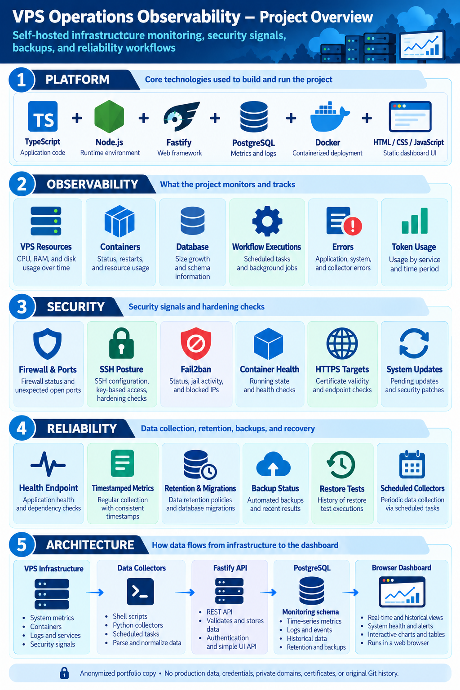
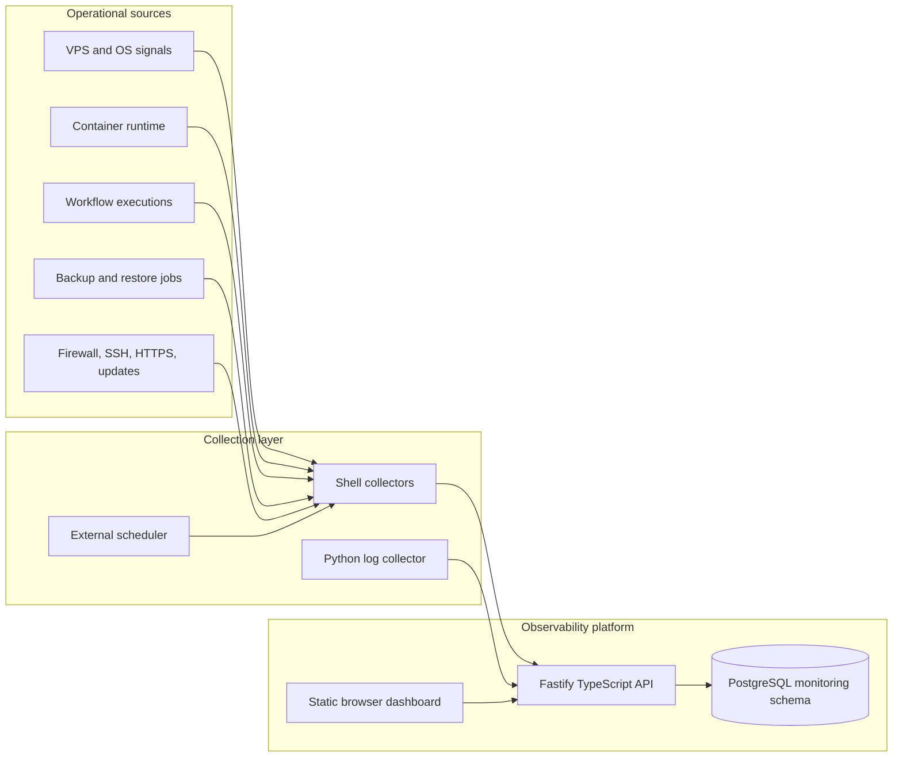

# VPS Operations Observability



An anonymized portfolio implementation of a self-hosted infrastructure observability platform.

This repository shows how operational signals from a VPS-based application environment can be collected, normalized, persisted, queried, and presented through a focused dashboard. It is intentionally structured as a public technical case study: the implementation patterns are preserved, while customer identity, production endpoints, credentials, certificates, operational exports, and the original Git history are not.

## What problem this solves

Self-hosted systems often have useful signals spread across shell commands, Docker, databases, workflow engines, backup jobs, and system logs. Without a consolidated view, it is difficult to answer basic operational questions:

- Is the host healthy and staying within resource limits?
- Are backups being completed and have restores actually been tested?
- Are containers, reverse-proxy targets, and HTTPS checks healthy?
- Are SSH failures, firewall changes, or service failures increasing?
- Are workflow executions succeeding, and which workflows are generating errors?
- How are database size, schemas, tables, and token usage changing over time?

The project addresses those questions with a small collection layer, a typed API, time-oriented database migrations, and a browser dashboard.

## Confirmed implementation areas

The following capabilities are represented in the source code and migrations:

### Host and container observability

- CPU, memory, disk, and filesystem usage samples
- Container counts, resource usage, health status, and restart observations
- Period-based queries for recent samples and daily summaries
- Disk-usage details grouped by operational category

### Backup and recovery observability

- Expected-versus-completed backup records
- Backup size and status history
- Restore-test history with duration, status, and validation details
- Separate tracking for backup-oriented workflows and monitored database structures

The public copy contains no backup archives or restored records. Restore commands are represented only as generalized implementation examples where safe.

### Workflow and automation observability

- Workflow execution counts and error counts
- Daily success-rate calculations
- Hourly error views
- Workflow-level error distribution
- Node and error-message fields in the dashboard data model

### Database observability

- Database size and configured capacity
- Connection measurements
- Schema and table counts
- Table, index, estimated-row, and total-size measurements
- Retention migrations for time-series-style monitoring data

### Security observability

The security model is observational: it records and displays security posture signals without pretending to replace a dedicated security platform. The implementation includes data structures and views for:

- Firewall state, listening ports, and unexpected ports
- SSH service state, root-login policy, password-authentication policy, and failed logins
- Fail2ban state and currently blocked sources
- Docker engine health, unhealthy containers, and restart counts
- Reverse-proxy and HTTPS target checks
- Certificate-expiration windows as reported by collectors
- Pending operating-system updates and reboot requirements
- Security-related events and operational log classification

### API and dashboard

- Fastify REST API with typed configuration and request validation
- Health endpoint for service checks
- Ingestion endpoints protected by a collector token
- Dashboard authentication through environment-provided configuration
- Period and tenant filters where the data model supports them
- Charts, summary cards, tables, sorting, and empty-state handling
- Static dashboard delivery through a reverse-proxy-compatible layout

## Architecture



The larger sanitized diagram is available in [docs/architecture.md](docs/architecture.md).

## Repository structure

```text
backend/
  collector/       Generalized VPS, security, and log collectors
  migrations/      PostgreSQL schema and retention migrations
  src/             Fastify API, configuration, authentication, and routes
  Dockerfile       Reproducible API image definition
dashboard/
  index.html       Static dashboard source
infra/dashboard/   Generic reverse-proxy and Compose examples
docs/              Public architecture documentation
.env.example       Placeholder-only local configuration
```

## Technology stack

- Node.js and TypeScript
- Fastify
- PostgreSQL-compatible SQL
- Docker and Docker Compose
- Static HTML, CSS, and JavaScript
- Shell collection scripts
- Python for log snapshot collection
- Mermaid for architecture documentation

## Local development

### Prerequisites

- Node.js compatible with the declared TypeScript toolchain
- pnpm
- PostgreSQL, either locally or through Docker
- Docker only if you want to exercise the container examples

### Configuration

Copy the placeholder configuration:

```bash
cp .env.example .env
```

Replace placeholders locally. Do not commit the resulting `.env` file.

### API

```bash
pnpm --dir backend install
pnpm --dir backend build
pnpm --dir backend dev
```

Apply the SQL files in `backend/migrations/` in filename order against a development database before using data endpoints. The migrations describe structures; they do not contain customer records.

### Dashboard

The dashboard is a static source example. In a local environment, serve it through a static server or the included reverse-proxy example and configure a local API/auth endpoint. No public deployment URL or production configuration is included.

## Security design

### Secret handling

- Runtime secrets are supplied through environment variables.
- `.env` files, private keys, certificates, dumps, backups, logs, and credentials are ignored by default.
- The public copy contains placeholder values such as `YOUR_COLLECTOR_TOKEN`, `YOUR_SESSION_SECRET`, and `example.invalid`.
- Collector authentication is represented by a bearer-style token passed at runtime, never hard-coded as a real value.

### Authentication and authorization boundaries

- Dashboard authentication is kept separate from collector ingestion.
- Ingestion routes require a collector credential when configured.
- Tenant-scoped queries are modeled explicitly rather than mixing customer data into global infrastructure measurements.
- The public repository does not contain user accounts or authentication exports.

### Network exposure

- The API is designed to sit behind a reverse proxy in deployment scenarios.
- Localhost bindings and example domains are placeholders, not production endpoints.
- HTTPS health checks and certificate-expiration observations are treated as monitored signals, not as certificates shipped with this repository.

### Data minimization

- No real leads, users, campaigns, messages, logs, IP inventories, backup archives, or production database exports are included.
- Customer-specific names, schemas, domains, paths, branded assets, and service names were generalized or removed.
- The original Git repository and its history were deliberately excluded.

## Observability and reliability practices

- Health checks provide a lightweight liveness signal.
- Metrics are stored with timestamps to support recent-window and daily views.
- Retention migrations limit the growth of monitoring tables.
- Backup completion and restore validation are modeled as separate concerns.
- Security events are classified by category, severity, and status for filtering.
- Empty and unavailable states are represented explicitly in the dashboard.
- Collector failures can be surfaced as ingestion or operational events instead of silently disappearing.

These are implementation patterns visible in the code. This portfolio copy does not claim any particular uptime, incident reduction, performance result, or production scale.

## What was anonymized or removed

- Customer and company names
- Brand marks and logos
- Real domains, hosts, IP addresses, email addresses, and private paths
- Production proxy rules and deployment-only service definitions
- Certificates and certificate files
- Backup and database exports
- Customer-specific documentation and operational checklists
- Original `.git` directory and all original commits

## Known limitations

- This is a portfolio copy, not a turnkey production deployment.
- External integrations require local configuration and credentials created by the operator.
- The dashboard contains source-level examples and requires a compatible API/auth configuration.
- The public copy has not been tested against the original production database or infrastructure.
- Dependency installation and end-to-end execution depend on the reader's local environment.

## Review status

The repository is prepared for human review, not publication. Before the first public commit, review the final tree, run the application checks in a clean environment, choose a license, and confirm that no additional proprietary material should be excluded.

## License

Add the license that matches your intended portfolio distribution before publication.
