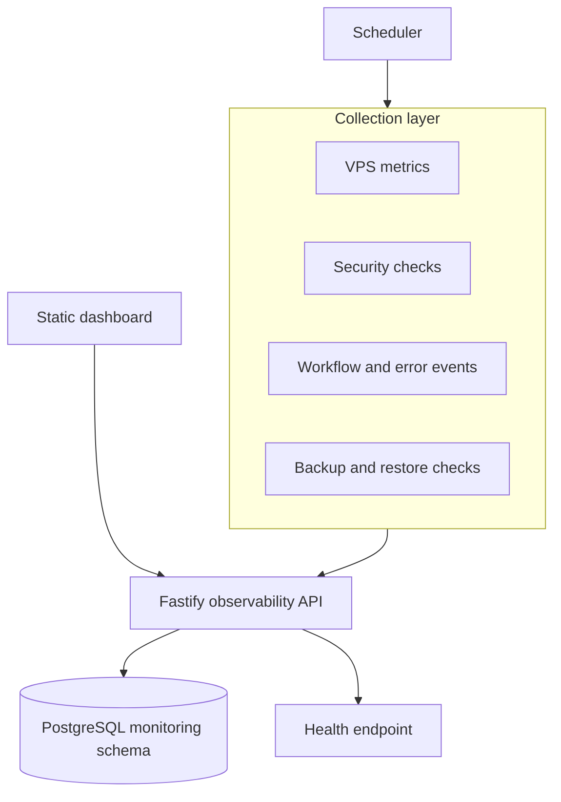

# Architecture

The public repository contains implementation examples and schema migrations. It does not contain customer names, production domains, real IP addresses, credentials, certificates, or operational exports.
